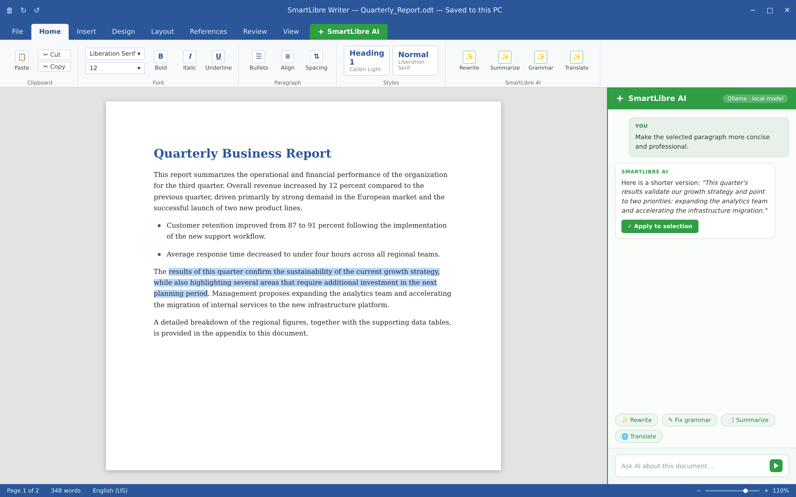

<div align="center">
  
  <h1>SmartLibre</h1>
  <p><strong>SmartLibre — LibreOffice with AI built in — Windows, Linux and macOS</strong></p>
  <a href="https://img.shields.io/badge/SmartLibre-AI%20office-2f9e44"></a>
  
  <a href="https://www.mozilla.org/en-US/MPL/2.0/"></a>
  <a href="../../discussions"></a>
  <p></p>
</div>

---

⚠️ **Early Access** ⚠️
SmartLibre is under active development and is currently in a **beta** stage. You may run into bugs, incomplete features, or settings that change between builds. Please report anything you find in [Issues](../../issues) — bug reports are incredibly valuable at this stage. Avoid using beta builds for critical, irreversible work without keeping backups of your documents.
---

## About

SmartLibre is a free, open-source and cross-platform **office suite** built on the LibreOffice engine (Writer, Calc, Impress and Draw), with an **AI assistant** integrated directly into the applications. It keeps every capability of classic LibreOffice — full support for `.odt`, `.ods`, `.odp` and excellent compatibility with Microsoft Office formats — and adds a local AI layer that can draft, rewrite, summarize and analyze text right where you work, inside the document window.

SmartLibre works with **any AI provider**: connect a cloud API (any OpenAI-compatible endpoint — OpenAI, OpenRouter, Azure, or your own hosted service) or run a **fully local model** via [Ollama](https://ollama.com) or LM Studio. When a local model is selected, your documents never leave your machine.

<div align="center">
  
  <p><sub>SmartLibre Writer with the built-in AI assistant — rewriting a selected paragraph in place, with a fully local Ollama model.</sub></p>
</div>

### Why your office suite needs AI

Most people work in a text editor for hours every day, and a large share of that time goes to mechanical work: rephrasing paragraphs, writing summaries of long documents, cleaning up formatting, drafting replies, translating sections. Switching to a browser tab and a chat window for each of these tasks breaks concentration and forces you to copy content back and forth.

With SmartLibre the assistant sits inside Writer, Calc and Impress. You select a paragraph and ask for a rewrite, select a table and ask what it means, or place the cursor in an empty page and ask for a first draft. The assistant sees the document context you explicitly share, so it works with your real content instead of a pasted fragment. The office suite remains the single place where all of your work happens.

### Privacy Precautions

SmartLibre gives you full control over where your documents go, but this control is only as strong as the choices you make. An AI provider sees whatever document content you explicitly send it. Follow these basic guidelines to keep your data safe:

* Choose a **local model** (Ollama, LM Studio) when working with confidential or personal documents — content then never leaves your computer
* If you use a **cloud provider**, remember that the selected text or prompt is sent to that provider's servers and is subject to their privacy policy
* Store your **API keys** only in the local SmartLibre configuration — never commit them to repositories, paste them into documents, or share screenshots that show them
* Use a provider account with **opt-out of training** where available, and review its data-retention terms
* Don't rely on the AI for facts without verification — models can make mistakes, and you are the author of the final document

_It is very important to note that no one associated with SmartLibre will ever ask for your API keys or your documents. Contributors may request example files that reproduce an issue, but please make sure such files contain no real confidential content._

### Versions

SmartLibre follows the LibreOffice release train: every new build is based on a recent, maintained release of the upstream engine, so behavior and file-format compatibility match the LibreOffice version noted on the release page. There is no separate legacy version to track — simply use the latest build.

All builds are produced from the source in this repository. No other platform or build channel is officially supported.

### Operating Systems

SmartLibre is officially supported on:

* Most Linux distributions (x64), such as Ubuntu and Fedora
* macOS (x64 and Apple Silicon¹)
* Windows 10 / 11 (x64)

¹ Apple Silicon builds are provided as universal binaries

## Portability

SmartLibre can run without installation. On Windows, place the extracted build in any folder and start it with a launcher like the sample below (`SmartLibreLauncher.bat`); the application then keeps its settings and AI configuration next to the executable instead of in the user profile.

```bat
@echo off
set SMARTLIBRE_PORTABLE=1
start "" "%~dp0SmartLibre.exe" %*
```

The same approach works on Linux and macOS by setting the `SMARTLIBRE_PORTABLE` environment variable before launching. This is convenient for USB sticks, locked-down workstations, or keeping several configurations side by side.

## Configuration

### Command-Line Arguments

SmartLibre accepts the standard LibreOffice command-line arguments, plus the following:

| Argument | Description |
| --- | --- |
| `--ai-provider <name>` | Temporarily override the active AI provider for this session |
| `--ai-off` | Start with the AI assistant disabled (plain LibreOffice mode) |
| `--settings <path>` | Load a specific settings file instead of the default one |
| `--safe-ai` | Start in AI sandbox mode: requests are logged but not sent |

### App Config

All settings live in a single JSON file: `smartlibre.json` in the user profile directory (or next to the executable in portable mode). It stores UI preferences, the list of configured AI providers, and assistant behavior options such as temperature and default actions. You can edit the file directly — SmartLibre picks up changes on the next start.

### AI Providers

Providers are configured under **Tools → Options → SmartLibre → AI Providers**. Each provider entry contains a name, an endpoint URL, an API key (for cloud providers) and a model name. Two types are supported out of the box:

* **OpenAI-compatible** — any endpoint implementing the `/v1/chat/completions` API: OpenAI, OpenRouter, Azure OpenAI, llama.cpp server, and others
* **Ollama** — automatic discovery of locally installed models, with no key or network access required

You can define as many providers as you like and switch between them at any time; the active provider is shown in the assistant sidebar.

### Offline Mode

When no provider is reachable — or AI is disabled entirely — SmartLibre behaves exactly like LibreOffice: every editing, formatting and export feature works without a network connection. Drafts and assistant requests written while offline are queued and can be re-sent once a provider is available again.

### Logs

Assistant requests and errors are written to `smartlibre.log` in the profile directory. Logging is minimal by default (provider name, model, token counts); enable verbose logging in the settings file to record full request bodies when debugging a provider. **Never share logs that contain document content** — sanitize them before attaching to an issue.

## Published Applications

### Linux

Linux builds are published on the [Releases](../../releases) page in several formats: `deb` and `rpm` packages for Debian/Ubuntu and Fedora-based distributions, an AppImage for everything else, and a Flatpak. The Flatpak build is sandboxed and receives automatic updates via the Flatpak runtime.

## Development

SmartLibre is an open-source project and contributions of every kind are welcome. The codebase consists of the LibreOffice core (patched) plus the AI layer: the assistant sidebar, provider integrations and configuration UI.

### Contributing

#### Features & Bug fixes

Before opening a pull request, please open an issue first to discuss the change — especially for new AI features, since provider behavior and UX are actively being designed. Pull requests should target the `main` branch, include a description of the change, and pass the CI checks. For bug fixes, add a regression test or a reproduction scenario whenever possible.

#### Translations

SmartLibre inherits the LibreOffice translation infrastructure and adds its own strings for the AI layer. If the assistant UI isn't available in your language, see the `i18n` directory for the string catalogs — new languages are always appreciated, and untranslated strings fall back to English.

#### Contributions

This project exists thanks to all the people who contribute code, bug reports, documentation and ideas. Every issue triaged and every patch reviewed makes the project better — thank you.

#### Backers

If SmartLibre saves you time and you'd like to support ongoing development, consider becoming a backer. Donations cover build infrastructure and the time spent maintaining releases.

#### Sponsors

Is your company using SmartLibre? Sponsoring the project helps ensure the AI layer keeps improving and stays free and open for everyone. Get in touch via the discussions page.

## Notes and Caveats

* SmartLibre is an **independent project** and is not affiliated with, endorsed by, or a product of The Document Foundation or the LibreOffice project
* SmartLibre is licensed under the **Mozilla Public License 2.0**, inherited from LibreOffice — the full text is in the `LICENSE` file
* The name "LibreOffice" is a trademark of The Document Foundation; this repository only describes the engine this project builds upon
* AI providers are third-party services governed by their own terms of service and privacy policies
* The AI assistant can produce incorrect or misleading output — always review generated content before publishing or sending it
